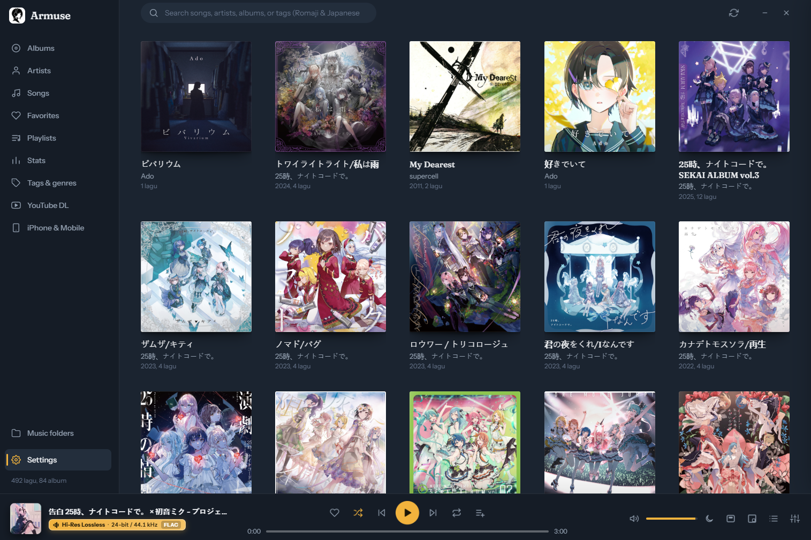
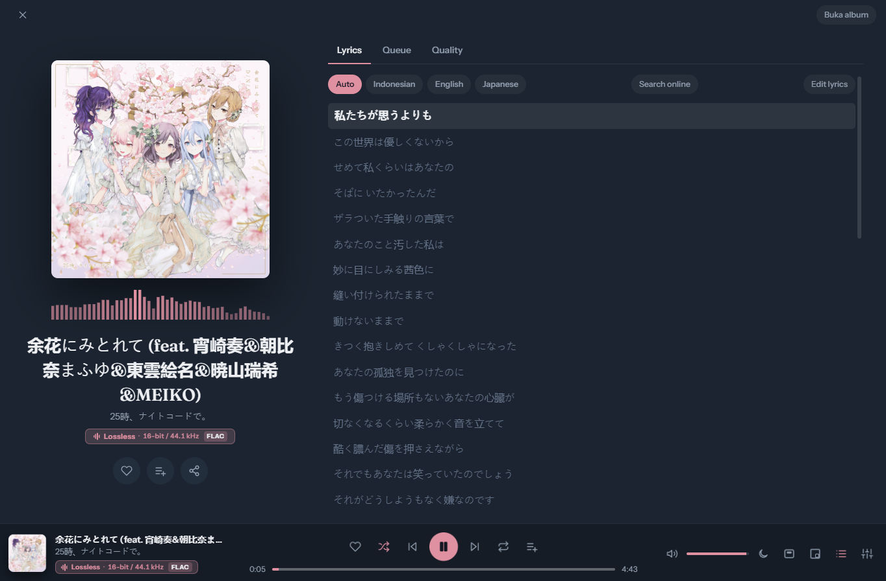
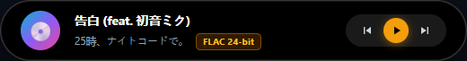
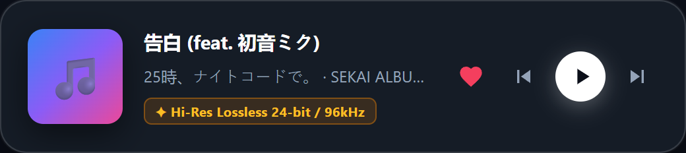
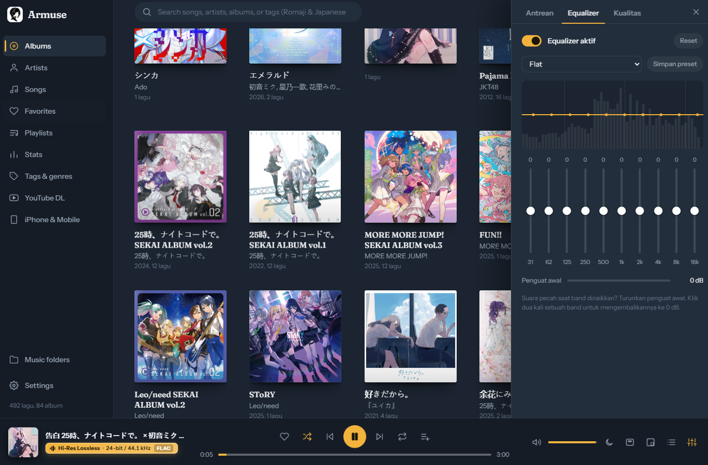
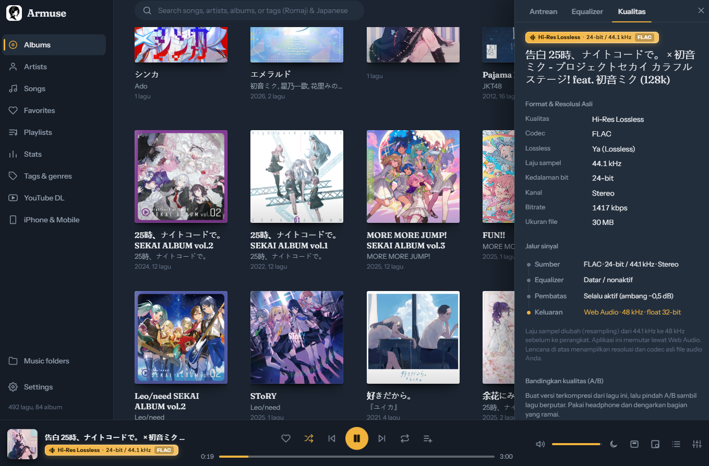
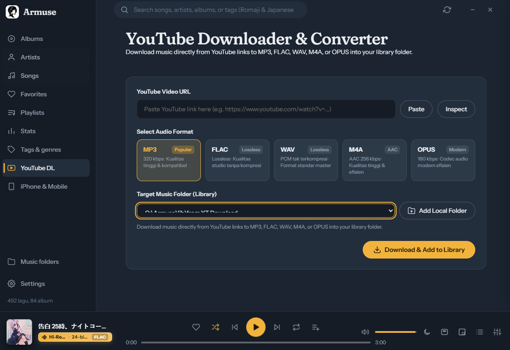
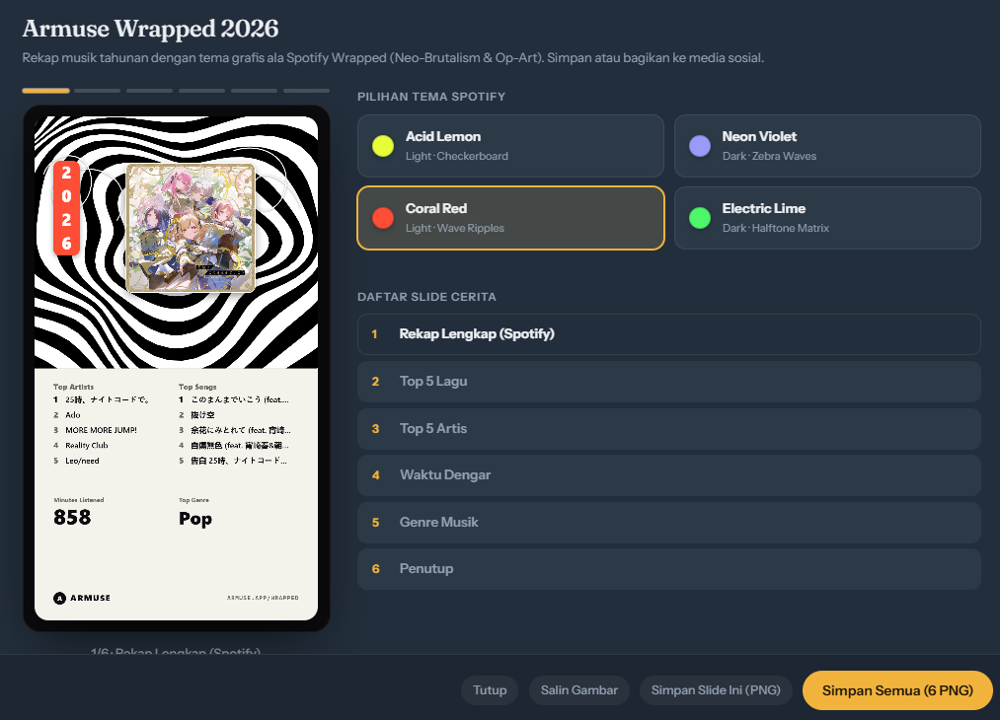

<p align="center">
  
</p>

<div align="center">

# Armuse

</div>

<div align="center">

  Armuse is a free, open-source music player without ads or tracking. Search for any song or artist, build playlists, and start listening.<br>
  Runs on Windows, macOS, and Linux.

</div>

<p align="center">
  <a href="https://github.com/senioralfath1-ux/Armuse-1.0.3/releases"></a>
  <a href="LICENSE"></a>
  <a href="https://saweria.co/alfaathhh"></a>
</p>

## Download

Grab the latest release for your platform from the [Releases page](https://github.com/senioralfath1-ux/Armuse-1.0.3/releases).

| Platform | Formats |
|----------|---------|
| Windows | `Armuse Setup 1.0.3.exe` |
| macOS | `Armuse-1.0.3.dmg` |
| Linux | `.AppImage`, `.deb` |

## Features

- Bit-perfect Hi-Res Lossless (>48 kHz / 24-bit), FLAC/ALAC, and Dolby Atmos audio playback
- 10-band real-time equalizer with anti-clipping limiter and custom presets
- Instant lossless vs compressed A/B listening comparison test
- Synchronized multi-tier lyrics with real-time fetching from LRCLIB and Kugou
- Smart multi-script search (`jpSearch`) with Romaji, Kanji, and Kana transliteration
- Full-screen Now Playing stage with interactive audio spectrum visualizer
- iOS-inspired Dynamic Island mini player with 5 multitasking slides (`Alt + I`)
- Floating Mini Player mode with quick playlist access and volume controls (`Alt + M`)
- Mobile Companion PWA for iPhone & Android over LAN with offline caching
- Google Drive cloud streaming with instant byte-range playback
- Built-in YouTube audio downloader with high-bitrate conversion (`yt-dlp` + `ffmpeg`)
- Listening habits stats and 6-slide exportable "Your Wrapped" recap (1080×1920)
- Light, Dark, and Liquid Glass themes with multi-language interface

## Screenshots

| Main Library & Album Grid | Now Playing & Synced Lyrics |
|:---:|:---:|
|  |  |

| Dynamic Island Mode (`Alt + I`) | Classic Floating Mini Player (`Alt + M`) |
|:---:|:---:|
|  |  |

| 10-Band Graphic Equalizer | Audio Signal Path & DAC Info |
|:---:|:---:|
|  |  |

| Built-in YouTube Downloader | Armuse Wrapped Annual Recap |
|:---:|:---:|
|  |  |

## Mobile Companion

Control Armuse or listen directly from your phone with the Mobile Companion PWA:

Open the **iPhone & Mobile** menu in the desktop app and scan the QR code (or navigate to `http://<your-pc-ip>:4000`). Add to Home Screen on iOS or Android for a native app experience with background audio and offline storage.

## Development

Armuse is built with Electron and modern web technologies.

### Prerequisites

- Node.js >= 18
- npm

### Getting started

```bash
git clone https://github.com/senioralfath1-ux/Armuse-1.0.3.git
cd Armuse-1.0.3
npm install
npm start
```

### Useful commands

```bash
npm start           # Run the player in dev mode
npm run dev         # Run with auto-reload (nodemon)
npm run dist        # Build production installers (.exe, .dmg, .AppImage)
```

## Shortcuts

| Shortcut | Scope | Action |
|----------|-------|--------|
| `Alt + I` | Global | Toggle Dynamic Island |
| `Alt + M` | Global | Toggle Mini Mode |
| `Alt + Space` | Global | Play / Pause in background |
| `Alt + ←` / `→` | Global | Previous / Next track |
| `Space` | App | Play / Pause |
| `Ctrl`/`Cmd` + `F` | App | Focus search bar |
| `A` / `B` | App | Switch A/B audio comparison |

## Community & Support

- ☕ **Saweria:** [saweria.co/alfaathhh](https://saweria.co/alfaathhh)
- ⭐ **GitHub:** Star the repository at [senioralfath1-ux/Armuse-1.0.3](https://github.com/senioralfath1-ux/Armuse-1.0.3)

## License

MIT. See [LICENSE](LICENSE).
