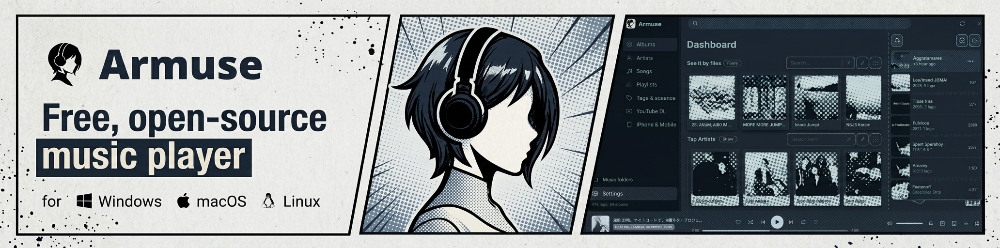

<div align="center">
  

  # Armuse

  **Pemutar musik desktop gratis & open-source untuk audiophile dan penikmat musik kasual.**  
  Tanpa iklan, tanpa pelacakan, dan 100% menghormati privasi data lokal Anda.

  **Tersedia untuk:** Windows • macOS • Linux • iPhone / Android (PWA)

  [](https://github.com/senioralfath1-ux/Armuse-1.0.3/releases)
  [](LICENSE)
  [](https://saweria.co/alfaathhh)
  [](https://github.com/senioralfath1-ux/Armuse-1.0.3/stargazers)
</div>

---

## Fitur Utama

- **Audio Audiophile & Bit-Perfect** — Deteksi otomatis Hi-Res Lossless (>48 kHz / 24-bit), FLAC/ALAC, Dolby Atmos (JOC), diagram rantai pemrosesan sinyal transparan, dan uji komparasi dengar A/B real-time tanpa jeda.
- **Equalizer 10-Band & Limiter** — Kontrol frekuensi 31 Hz–16 kHz (±12 dB), 11 preset bawaan + custom, kurva respons interaktif, dan pemilihan perangkat output (DAC eksternal) langsung.
- **Lirik Sinkron Multi-Tier** — Pengambilan lirik otomatis via LRCLIB & Kugou (J-Pop, Romaji, Barat, Indonesia), navigasi lompat detik klik-per-baris, dan editor lirik manual.
- **Pencarian Pintar Multi-Aksara (`jpSearch`)** — Transliterasi otomatis dua arah Romaji ↔ Hiragana ↔ Katakana ↔ Kanji untuk pencarian lagu Anime/J-Pop tanpa repot ganti keyboard IME.
- **Layar Now Playing & Visualizer** — Tampilan panggung resolusi penuh dengan sampul besar, lirik sinkron, dan spektrum audio visualizer real-time yang dinamis.
- **Dynamic Island & Mode Mini** — Kapsul multitasking 5-slide bergaya iOS (`Alt+I`) dengan auto-dock di tepi atas layar, Mode Mini klasik (`Alt+M`), dan System Tray background player.
- **Aplikasi Pendamping HP (PWA Port 4000)** — Pindai QR untuk akses pemutar bergaya Apple Music di iPhone/Android melalui jaringan lokal (`http://al.local:4000`), lengkap dengan kontrol layar kunci dan simpan offline (IndexedDB).
- **Google Drive Cloud Streaming** — Putar langsung folder publik Google Drive secara instan (*byte-range streaming*) tanpa perlu menunggu unduh penuh, didukung smart cache LRU offline.
- **YouTube Audio Downloader** — Unduh audio dari URL YouTube langsung ke pustaka musik lokal dalam format MP3 320 kbps, FLAC, WAV, M4A, atau Opus (`yt-dlp` + `ffmpeg`).
- **Statistik & "Wrapped Kamu"** — Rekap kebiasaan mendengar 6-slide ala Spotify Wrapped (1080×1920) dan kartu cerita lagu siap ekspor PNG.
- **3 Tema Visual & Multi-Bahasa** — Tema Dark (biru laut khas Armuse), Light, dan Liquid Glass (efek kaca cair iOS), serta antarmuka Bahasa Indonesia, English, dan 日本語.

---

## Unduh & Pemasangan

| Sistem Operasi | Berkas Instalasi | Panduan |
|---|---|---|
| **Windows** | `Armuse Setup 1.0.3.exe` | Unduh dari [Releases](https://github.com/senioralfath1-ux/Armuse-1.0.3/releases) lalu jalankan installer |
| **macOS** | `Armuse-1.0.3.dmg` | Buka file `.dmg` dan seret ikon ke folder `Applications` |
| **Linux (AppImage)** | `Armuse-1.0.3.AppImage` | Beri izin eksekusi (`chmod +x`), lalu jalankan |
| **Linux (Debian/Ubuntu)** | `armuse_1.0.3_amd64.deb` | Pasang via `sudo apt install ./armuse_1.0.3_amd64.deb` |

---

## Development

### Persyaratan
* [Node.js](https://nodejs.org) (v18 atau lebih baru)
* npm atau pnpm

### Menjalankan dari Kode Sumber
```bash
# Clone repositori
git clone https://github.com/senioralfath1-ux/Armuse-1.0.3.git
cd Armuse-1.0.3

# Pasang dependensi
npm install

# Jalankan aplikasi (Development mode)
npm start
```

### Membuat File Installer (Build)
```bash
npm run dist
```
Paket instalasi siap pakai akan dibuat di dalam direktori `dist/`.

---

## Pintasan Keyboard Utama

| Pintasan | Lingkup | Fungsi |
|---|---|---|
| `Alt + I` | Global | Buka / tutup mode **Dynamic Island** |
| `Alt + M` | Global | Buka / tutup **Mode Mini** klasik |
| `Alt + Space` | Global | Putar / jeda musik di latar belakang |
| `Alt + ←` / `→` | Global | Lagu sebelumnya / berikutnya |
| `Spasi` | Dalam Aplikasi | Putar / jeda pemutaran lagu |
| `Ctrl`/`Cmd` + `F` | Dalam Aplikasi | Fokus ke kotak pencarian |
| `A` / `B` | Dalam Aplikasi | Beralih instan perbandingan audio Asli (A) & Kompresi (B) |

---

## Penyimpanan Data & Mode Portabel

Pustaka, preferensi, playlist, dan cache disimpan secara lokal di:
- **Windows:** `%APPDATA%\Armuse`
- **macOS:** `~/Library/Application Support/Armuse`
- **Linux:** `~/.config/Armuse`

Untuk mode portabel (mis. flashdisk), gunakan variabel lingkungan:
```bash
ARMUSE_DATA_DIR=/path/ke/folder-data npm start
```

---

## Dukungan & Komunitas

**Armuse** dikembangkan secara independen dan gratis untuk semua orang. Dukungan Anda sangat berarti untuk kelangsungan pengembangan fitur-fitur baru:

* ☕ **Dukung lewat Saweria:** [saweria.co/alfaathhh](https://saweria.co/alfaathhh)
* ⭐ **Beri Star di GitHub:** [senioralfath1-ux/Armuse-1.0.3](https://github.com/senioralfath1-ux/Armuse-1.0.3)

---

## Lisensi

Proyek ini dilisensikan di bawah **[MIT License](LICENSE)** — bebas digunakan, dimodifikasi, dan didistribusikan.